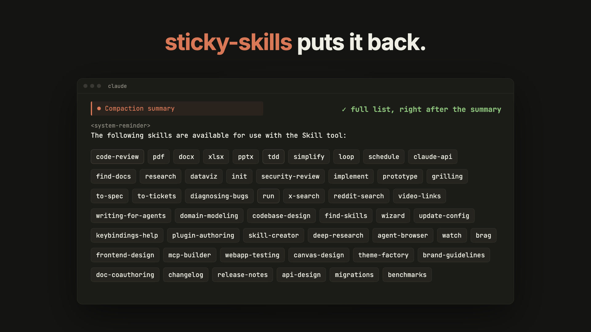

# sticky-skills

Compaction wipes Claude Code's skill map <br/>
<br/>
... **_sticky-skills_ puts it back.**



https://github.com/user-attachments/assets/48c25e26-1b26-4412-b986-aaa8b63f8994

It's been a long session. Claude has compacted a few times. 

You tell Claude to do something. You've got a few relevant skills it normally finds on its own... 

... _but now Claude doesn't load the skills._ 

What happened?

After a compaction, the full list of skills that Claude gets in the system prompt is gone,
unless you specifically invoke them. 

_sticky-skills_ is a Claude Code mod that puts the full list back right after the
compaction summary. 

**If your workflow requires Claude to find skills automatically without you specifically invoking them, you need this mod.**


## Install

```sh
claude plugin marketplace add Jakobbarnwell/sticky-skills
claude plugin install sticky-skills@sticky-skills
```

Takes effect in new sessions.

## How it works

- It takes the same "skills catalogue" list that Claude Code gets at the beginning of the session, then adds the full list again as a
  message right after the compaction summary. 
- When Claude Code later sends a listing of its own, only entries the
  conversation doesn't already hold go through, so the list never appears
  twice, including in a resumed session.
- Subagents keep their own list and are left alone.
- It's the same list Claude Code sends: names and descriptions only. Skill
  bodies still load only when a skill is used.

Limits: 
- a skill removed mid-session stays in the restored list until the
session ends.
- Codex doesn't need this: its compacted history keeps the skills.

## License

MIT
